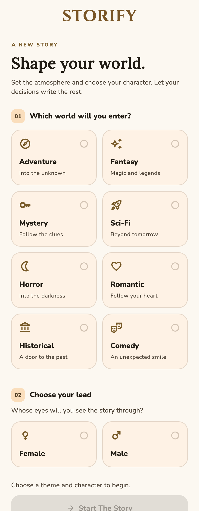

# Storify

**English** · [Türkçe](README.tr.md)

Storify is an interactive storytelling app for Android and iOS. Choose a genre and protagonist, read a passage, and decide what happens next. Explore branching guest stories or sign in to create a story with AI in Turkish or English.

## Features

- **Stories shaped by your choices:** Three choices per passage guide the next part of the story, with previous events carried into AI continuations.
- **Eight genres:** Adventure, fantasy, mystery, science fiction, horror, romance, historical fiction, and comedy. Choose a protagonist or let the app surprise you.
- **Guest stories:** Explore bundled stories with branching endings in both languages, without making AI requests. Initial guest sign-in requires an internet connection.
- **AI storytelling:** Registered users can generate stories, continue their latest saved AI story on the same device, and reach an ending within 30 passages.
- **Accounts:** Email/password and Google sign-in, password reset, profile editing, and account deletion. Apple sign-in is implemented for iOS and requires provider setup.
- **Content controls:** Permission before AI sharing, moderation of generated passages and choices, and in-app story reporting.
- **Personalization:** Turkish and English support, light and dark themes, and responsive layouts in Storify's brown and gold palette.

## Screenshots

App screens with sample stories:

  

<details>
<summary>Dark theme</summary>


</details>

## Data and privacy

The latest AI story and preferences are stored on your device; stories do not sync between devices. Firebase handles authentication, profile images, and submitted content reports. After permission is granted, AI generation sends story context and choices to OpenAI. You can withdraw this permission in the app. Storify contains no ads, purchases, or usage analytics integrations.

Account deletion requires reauthentication and removes associated files, local story data, and the account.

[Data handling](docs/DATA_AND_PRIVACY.md) · [Release checklist](docs/release_preparation.md)

## Development

The app is in development. Before distribution, AI requests must move from the client-side development key to an authenticated backend. Signing, public privacy and account-deletion pages, and physical-device checks are also pending.

Storify is built with Flutter. It uses Bloc/Cubit for state management, SharedPreferences for local story progress and preferences, and Firebase for authentication and file storage. Translations are managed with `easy_localization`.

```sh
git clone https://github.com/emrealidemirel/storify.git
cd storify
flutter pub get
cp .env.example .env
flutter run
```

Configure Firebase providers and a local development key before testing the corresponding features. Never distribute builds containing an AI provider key.

Run static analysis and tests:

```sh
flutter analyze --no-pub
flutter test --no-pub
```

See the [development guide](docs/DEVELOPMENT.md) for configuration, architecture, Storage-rule tests, and build commands.

## Support

Developed by [Emre Ali Demirel](https://github.com/emrealidemirel).

Other projects: [Shien](https://github.com/emrealidemirel/shien) · [BugPilot AI](https://github.com/emrealidemirel/bugpilot-ai)

For questions and feedback: [emrealidemirel@gmail.com](mailto:emrealidemirel@gmail.com)
