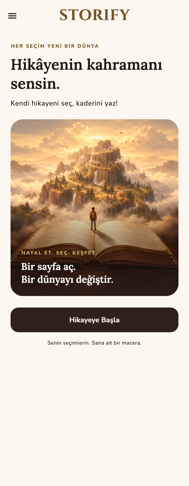
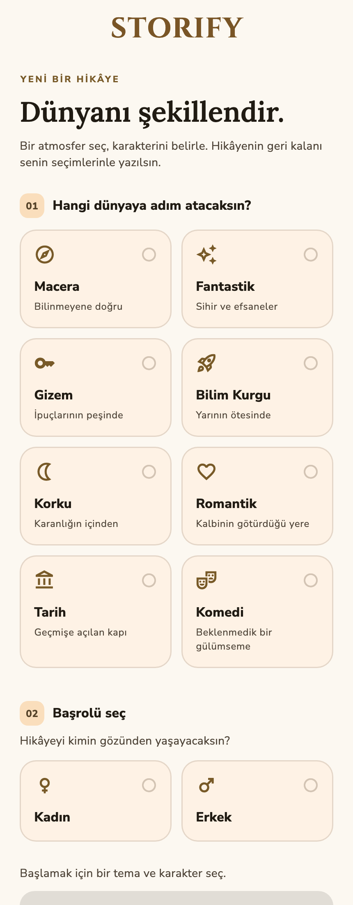
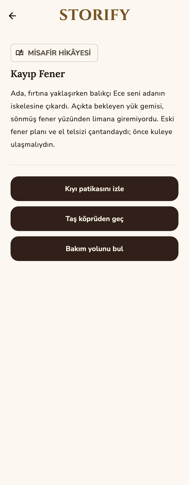

# Storify

[English](README.md) · **Türkçe**

Storify, Android ve iOS için geliştirilmiş etkileşimli bir hikâye uygulamasıdır. Hikâyenin türünü ve kahramanını seç, bir bölümü oku ve sırada ne olacağına karar ver. Türkçe veya İngilizce hazır misafir hikâyelerini keşfedebilir ya da giriş yaparak yapay zekâyla kendi hikâyeni oluşturabilirsin.

## Özellikler

- **Seçimlerinle şekillenen hikâyeler:** Her bölümde sunulan üç seçenek, hikâyenin devamına yön verir. Yapay zekâ önceki olayları devam bölümlerinin bağlamında kullanır.
- **Sekiz tür:** Macera, fantastik, gizem, bilim kurgu, korku, romantik, tarihî ve komedi. Kahramanını seçebilir veya seçimi uygulamaya bırakabilirsin.
- **Misafir hikâyeleri:** İki dilde, farklı sonlara ulaşan hazır hikâyeleri AI isteği yapmadan keşfet. İlk misafir girişi internet bağlantısı gerektirir.
- **Yapay zekâyla hikâye:** Kayıtlı kullanıcılar hikâye oluşturabilir, aynı cihazda son kaydedilen AI hikâyesine devam edebilir ve en fazla 30 bölümde sona ulaşabilir.
- **Hesap yönetimi:** E-posta/şifre ve Google ile giriş, şifre sıfırlama, profil düzenleme ve hesap silme. iOS için Apple ile giriş kodu mevcut; sağlayıcı yapılandırması gerektirir.
- **İçerik kontrolleri:** AI paylaşımı öncesinde izin, üretilen metin ve seçeneklerde moderasyon ve uygulama içinden hikâye bildirme.
- **Kişiselleştirme:** Türkçe ve İngilizce dil desteği, açık ve koyu tema; Storify'nin kahverengi ve altın paletinde farklı ekran boyutlarına uyumlu arayüz.

## Ekran görüntüleri

Uygulamanın gerçek Flutter ekran bileşenleri ve paket içindeki misafir hikâyeleriyle oluşturulmuş görüntüler. Türkçe ve İngilizce çekimler mevcut; canlı hesap veya AI isteği kullanılmaz.

  

<details>
<summary>Koyu tema</summary>


</details>

Görüntüleri yeniden üretmek için [çekim rehberine](docs/store/screenshots/README.md) bakabilirsin.

## Veriler ve gizlilik

Son AI hikâyesi ve tercihler cihazda saklanır; hikâyeler cihazlar arasında senkronize edilmez. Kimlik doğrulama, profil fotoğrafları ve gönderilen içerik bildirimleri için Firebase kullanılır. İzin verildikten sonra AI üretimi için hikâye bağlamı ve seçimler OpenAI'a gönderilir. Bu izin uygulama içinden geri alınabilir. Storify reklam, satın alma veya kullanım analitiği entegrasyonu içermez.

Hesap silme işlemi yeniden kimlik doğrulaması yapar; ilgili Storage dosyalarını ve yerel hikâye/izin verilerini temizledikten sonra kimlik doğrulama hesabını siler. Canlı sağlayıcı ayarları ve Storage izinleri yayın öncesinde ayrıca doğrulanmalıdır.

Uygulama **geliştirme aşamasındadır ve genel dağıtıma hazır değildir**. AI üretimi ve moderasyon şu anda uygulama paketindeki geliştirme anahtarını kullanır; yayın öncesinde bu istekler kimlik doğrulayan bir sunucuya taşınmalıdır. İmzalama, herkese açık gizlilik/hesap silme sayfaları ve gerçek cihaz doğrulamaları da beklemektedir.

[Veri işleme açıklaması](docs/DATA_AND_PRIVACY.md#türkçe) · [Yayın kontrol listesi](docs/release_preparation.md)

## Geliştirme

Storify, Flutter ile geliştirilmiştir. Durum yönetiminde Bloc/Cubit, yerel hikâye ilerlemesi ve tercihler için SharedPreferences, kimlik doğrulama ve dosya depolama için Firebase kullanılır. Çeviriler `easy_localization` ile yönetilir.

```sh
git clone https://github.com/emrealidemirel/storify.git
cd storify
flutter pub get
cp .env.example .env
flutter run
```

İlgili özellikleri test etmeden önce Firebase sağlayıcılarını ve yerel geliştirme anahtarını yapılandır. AI sağlayıcı anahtarı içeren derlemeleri dağıtma.

Kod ve test kontrolleri:

```sh
flutter analyze --no-pub
flutter test --no-pub
```

Yapılandırma, mimari, Storage kuralı testleri ve derleme komutları [geliştirme rehberinde](docs/DEVELOPMENT.md) açıklanır. Doğrulanan kontroller ve kalan işler [son proje incelemesinde](docs/project_review_2026-11-01.md) yer alır.

## Destek

[Shien](https://github.com/emrealidemirel/shien) uygulamasının da geliştiricisi olan [Emre Ali Demirel](https://github.com/emrealidemirel) tarafından geliştirilmiştir.

Sorular ve geri bildirimler için: [emrealidemirel@gmail.com](mailto:emrealidemirel@gmail.com)
